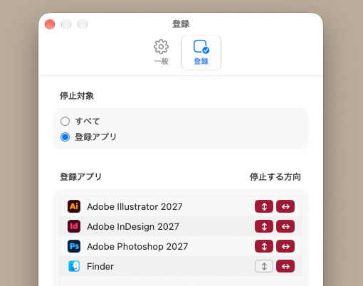
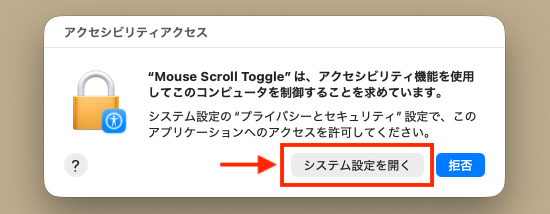
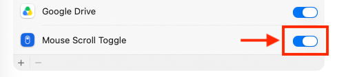

# Mouse Scroll Toggle

macOS用デスクトップアプリ

## ダウンロード

[Mouse-Scroll-Toggle-140.zip](https://github.com/monokano/Mouse-Scroll-Toggle/releases/download/1.4.0/Mouse-Scroll-Toggle-140.zip)
 [更新内容](https://github.com/monokano/Mouse-Scroll-Toggle/releases)

## 用途

Mouse Scroll Toggleは、マウスのスクロールを停止するユーティリティアプリです。メニューバーやDockに常駐して動作します。

## 機能

- **停止対象**：すべてのアプリで停止するか、登録したアプリだけ停止するかを選べます。
- **停止するスクロール方向**：垂直方向のみ、水平方向のみ、両方とも停止を選べます。登録したアプリごとに設定できます。
- **一時解除**：選んだ修飾キーを押している間だけ、停止中でもスクロールできます（デフォルトは⌘キー）。

詳細は、Mouse Scroll Toggleのヘルプを参照してください。

### Macの制御を許可する

Mouse Scroll Toggleがスクロールを停止するには、Macを制御する許可が必要です。スクロールの操作を受け取って停止するために使います。許可がないと、スクロールを停止できません。許可がないときは、次のように知らせます。

- メニューバーのアイコンが警告の三角形になります。クリックすると、許可を求めるダイアログが表示されます。
- Dockのアイコンのメニューに「⚠️ Macを制御する許可が必要」が表示されます。選ぶと、許可を求めるダイアログが表示されます。

ダイアログの「システム設定を開く」をクリックすると、許可を設定する場所が開きます。

Mouse Scroll Toggleをオンにします。これで許可されます。

## 動作環境

macOS 13.5 Ventura 以降（Universal Binary）

## ライセンス

This project is licensed under the MIT License - see the [LICENSE](LICENSE) file for details.
